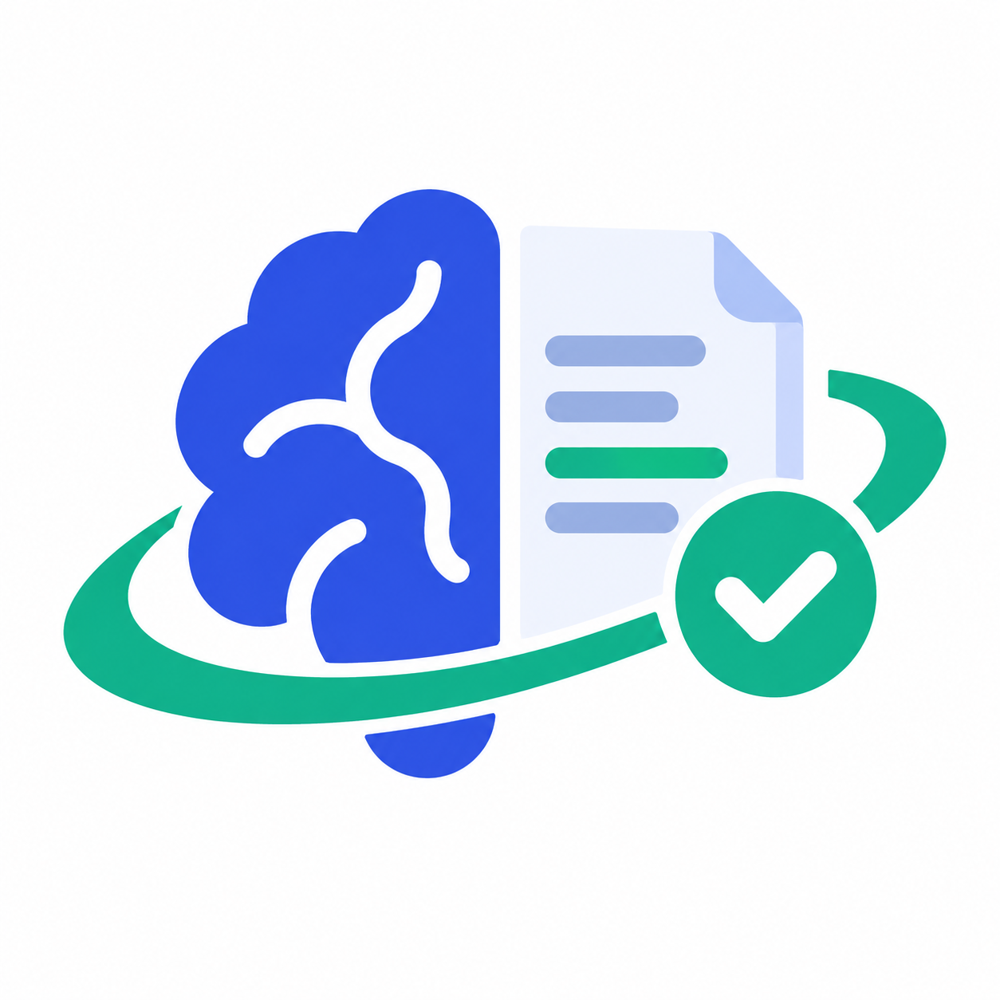
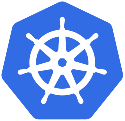

  

## Software Engineer | Full-Stack & Systems

**Building practical software with strong fundamentals, from modern web applications to the systems underneath.**

## About Me

I'm a Computer Science and Engineering undergraduate, interested in building reliable software and understanding the systems behind it.

- **Full-Stack Development** — Building web applications with React, Next.js, TypeScript, and Node.js.
- **Backend & AI Systems** — Exploring backend engineering, retrieval-augmented generation (RAG), and evidence verification.
- **Linux & Developer Tools** — Passionate about open source, terminal-first workflows, Neovim, and Emacs.
- **Open Source** — Contributed to Kubernetes documentation localization in Bengali.
- **Computer Science Fundamentals** — Strengthening my knowledge of data structures, algorithms, software design, and system internals.
- **Long-Term Goal** — Becoming a well-rounded software engineer who understands not only how to use frameworks, but also how things work underneath.

> _Learn the fundamentals. Build real things. Understand what happens underneath._

---

## 🛠️ Tech Stack

### Languages

### Frontend & Backend

### AI, Systems & Tools

---

## 🔥 Featured Projects

<table>
<tr>
<td width="50%" valign="top">

###  [Live Doc](https://github.com/sojibulislamrana/live-docs) · [Live Demo](https://live-docs-mu-nine.vercel.app)

A collaborative document editor inspired by Google Docs, focused on real-time teamwork and document management.

**Highlights**

- Real-time collaborative editing
- Shared document workspaces
- Modern web application architecture

**Stack:** Next.js · React · TypeScript · Convex · Clerk

</td>
<td width="50%" valign="top">

###  [UniShop](https://github.com/sojibulislamrana/unishop-c) · [Live Demo](https://unishop-client.vercel.app)

A modern, minimalist e-commerce platform tailored for university students with direct-to-dorm delivery and instant online checkout.

**Highlights**

- Curated student catalog Persistent shopping cart
- Live navbar badge promo codes & card payments
- Store management dashboard with live revenue metrics & order status tracking

**Stack:** Next.js 16 · Node.js · Express · MongoDB

</td>
</tr>
<tr>
<td width="50%" valign="top">

###  [One Thing — macOS Menu Bar App](https://github.com/sojibulislamrana/OneThing-MacOS-menubar-app)

A lightweight native macOS utility for keeping a single priority or note accessible from the menu bar.

**Stack:** Swift · macOS · AppKit/SwiftUI

</td>
<td width="50%" valign="top">

### ⚡ [Awesome CLI Task Manager](https://github.com/sojibulislamrana/awesome-cli-taskmgr)

A keyboard-driven command-line task manager for organizing tasks, priorities, tags, and deadlines.

**Stack:** JavaScript · Node.js · CLI

</td>
</tr>
<tr>
<td width="50%" valign="top">

###  [HalluFix](https://github.com/sojibulislamrana/Hallufix-An-Evidence-First-Hybrid-RAG-Framework-for-Mitigating-AI-Hallucination)

An evidence-first hybrid RAG framework designed to reduce unsupported AI answers through retrieval, verification, and abstention.

**Stack:** Python · FastAPI · FAISS · NLI · Next.js

</td>
<td width="50%" valign="top">

###  [Kubernetes Website](https://github.com/kubernetes/website)

Contributed to Kubernetes documentation localization, helping make technical content more accessible to Bengali-speaking developers.

**Focus:** Open source · Documentation · Bengali localization

</td>
</tr>
</table>

## Latest YouTube Videos

 
<table>
  <tbody>
<!-- YOUTUBE:START -->
<tr>
  <td></td>
  <td><a href="https://youtu.be/pOrpung-s4E">Anatomy of Matplotlib | Sojibul Islam Rana | Dev Change Makers</a> Jan 19, 2024</td>
</tr>
<tr>
  <td></td>
  <td><a href="https://www.youtube.com/watch?v=kViGwIcuwI0">Build your own ChatGPT using Hugging Face API</a> Mar 21, 2024</td>
</tr>
<tr>
  <td></td>
  <td><a href="https://www.youtube.com/watch?v=t958xTS_RSU">Build your own AI Image Generator like Stable Diffusion</a> Dec 9, 2023</td>
</tr>
<!-- YOUTUBE:END -->
  </tbody>
</table>

---

## GitHub Statistics

---

## Education & Learning

- [CS50: Introduction to Computer Science — Harvard University](https://cs50.harvard.edu/x/)
- Machine Learning Specialization — Andrew Ng / DeepLearning.AI
- Complete Web Development Course — Programming Hero, Batch 12

---

## Connect

 

